# OBS Multistream Chat

Plugin id / folder / DLL name: `obs-multistream-chat`. (Renamed from `obs-multistream`.) Since 0.2.0 the name is literal: the plugin also merges the live chat of your channels.

Send the one stream OBS already encodes to several RTMP(S) destinations at once, with a dock for you
and a browser-source overlay for your viewers. **No platform APIs, no OAuth, no relay service:** each
destination is a plain RTMP(S) URL plus that platform's stream key. Native C++ plugin for OBS Studio
32.2.2 (Windows x64). Licence GPL-2.0-or-later.

- **Dock (for you):** a table of destinations with a status dot (green live, amber degraded or
  reconnecting, red failed, grey idle), bitrate, dropped %, uptime, per-row start/stop, enable
  toggles, an add/edit dialog (key masked, reveal button), and a banner when your encoder or network
  is the bottleneck.
- **Overlay (on stream):** a browser source showing each platform's icon with your handle next to it.
  An icon lights up only while that destination is genuinely connected and sending, dims when idle,
  and pulses while reconnecting.
- **Merged chat (new in 0.2.0, optional):** the chat of your Twitch, YouTube, Kick, TikTok and X
  channels in one browser source, each line with a small icon of where it came from. It works
  **without any platform API, OAuth or login**: a small Node program reads each channel's public chat
  *page* in a hidden Chrome of its own. See [Merged chat](#merged-chat) before you use it: it may be
  against a platform's terms, and TikTok and X are experimental.
- **Shared encoders by default:** extra destinations reuse the main stream's encoders, so no extra
  NVENC session and no extra GPU load. A separate encode per destination is optional.
- **Per-destination canvas and audio track (new in 0.3.0):** a destination can stream the main canvas or
  any other OBS canvas (for example the vertical canvas Aitum Stream Suite creates), with its own encoder
  (x264 by default, or any installed hardware encoder), and can carry any OBS mixer track 1 to 6.
- **Optional Aitum Stream Suite output settings (new in 0.3.0):** copy or follow the output settings
  Aitum already has, while this plugin runs the outputs. Any number of outputs at once: nothing is shared
  between destinations. See [docs/aitum.md](docs/aitum.md).

Status: see [CHANGELOG.md](CHANGELOG.md). It has **not** been loaded into a real OBS or streamed to a
real platform yet; read [docs/limits.md](docs/limits.md) first.

## Install

### Recommended: Windows Setup Installer
Download and run **`obs-multistream-chat-<version>-windows-x64-setup.exe`** from the [Releases](https://github.com/otissy/obs-multistream-chat/releases).
- Automatically installs to `C:\ProgramData\obs-studio\plugins\obs-multistream-chat`.
- Safely closes OBS if running during install.
- Provides a clean Windows uninstaller.

### Portable ZIP Archive
Close OBS, extract `obs-multistream-chat-<version>-windows-x64.zip` so that the `obs-multistream-chat` folder ends up in `C:\ProgramData\obs-studio\plugins\`.

Start OBS, then open the dock from **Docks > OBS Multistream Chat** (or **Tools > OBS Multistream Chat**), and follow the [Quick start](#quick-start-5-minutes).

### Building from Source (Developers)
Needs Visual Studio Build Tools 2022 with *Desktop development with C++*:
```
powershell -ExecutionPolicy Bypass -File scripts\build.ps1 -Test
powershell -ExecutionPolicy Bypass -File scripts\package.ps1
```

## Quick start (5 minutes)

The pictures are the real dock (taken from the 0.5.0 test build, the same dock as 0.5.1) in a test copy of OBS 32.2.2, with sample channels and sample chat.
The same steps, with the same pictures, open at the end of Setup (`docs/quickstart.html`, also in the Start menu).

**1. Open the panel.** In OBS: **Docks > OBS Multistream Chat** (or **Tools > OBS Multistream Chat**). Drag it
next to your other docks. Until you are set up it shows a **Get started** card with three steps; each has a
button that takes you to the right place and ticks itself off when it is done.

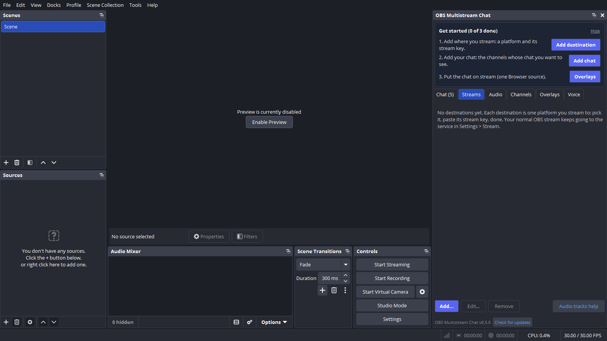

**2. Add where you stream.** Press **Add destination** (or **Streams > Add...**). Pick the platform, paste its
stream key (from the platform's dashboard, see the table under [Setup](#setup)) and type the handle you want
shown on stream. That is all: the server URL is filled in for platforms that have one fixed ingest, and the
name follows the platform. Your normal OBS stream keeps going to the service in *Settings > Stream*; add
each *extra* platform here.

| First run | Add a destination |
|---|---|
| 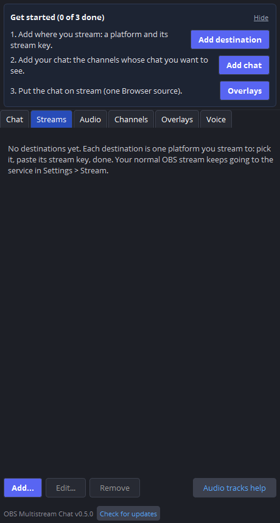 | 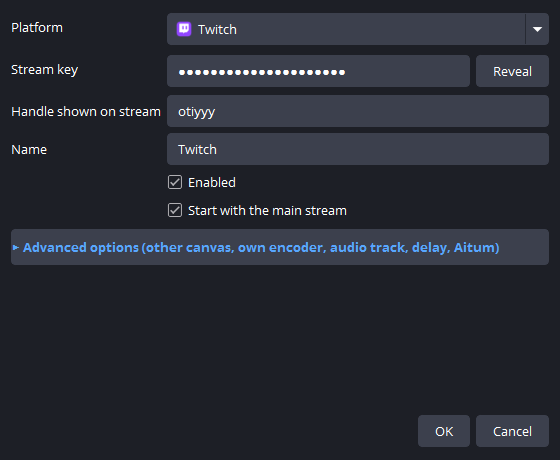 |

Need another canvas (vertical TikTok), an own encoder, a delay or Aitum's settings? Open **Advanced options**
in the same dialog ([details](#canvas-encoder-and-audio-track-per-destination-030)). It opens by itself when
you edit a destination that already uses any of them.

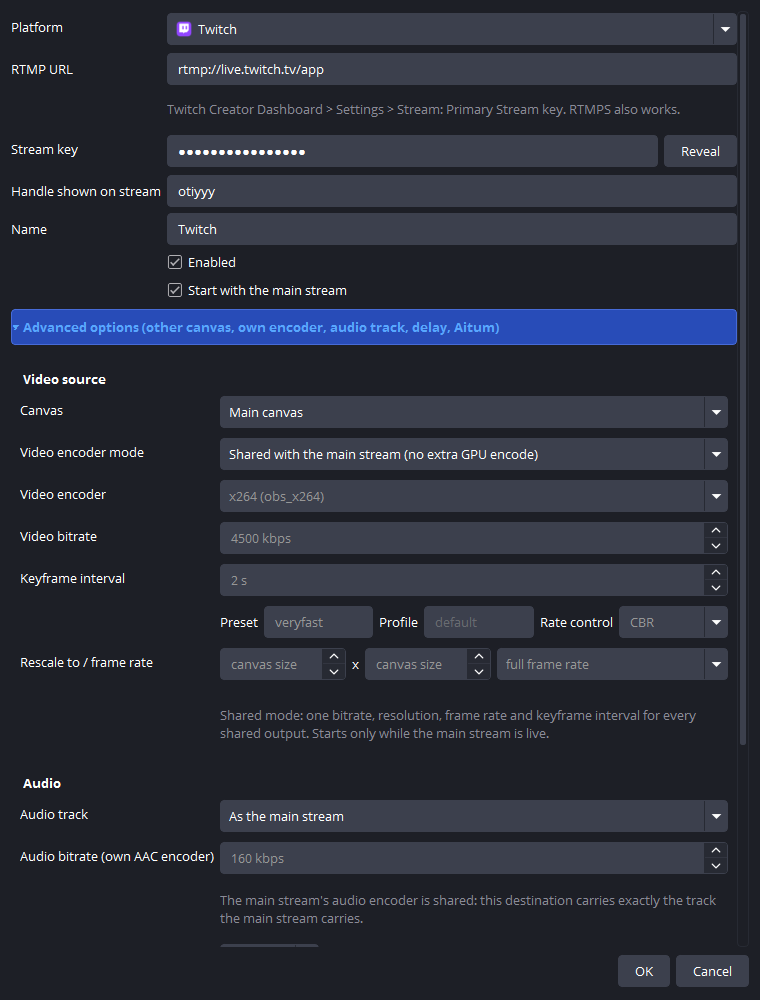

**3. Give each platform its sound.** On the **Audio** tab, pick the OBS audio track each destination sends
(for example: no music on YouTube). The meters show what is on each track right now, and a destination whose
track has been silent for 5 seconds says so. Which sources go on which track is set in OBS's **Advanced Audio
Properties** (the tab has a button that opens it); the [audio guide](#canvas-encoder-and-audio-track-per-destination-030)
has the details.

| Streams | Audio |
|---|---|
| 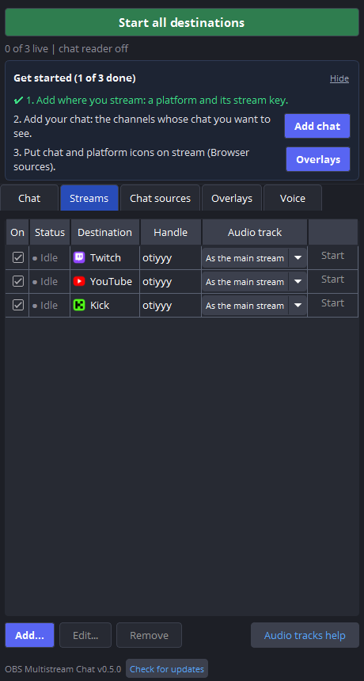 | 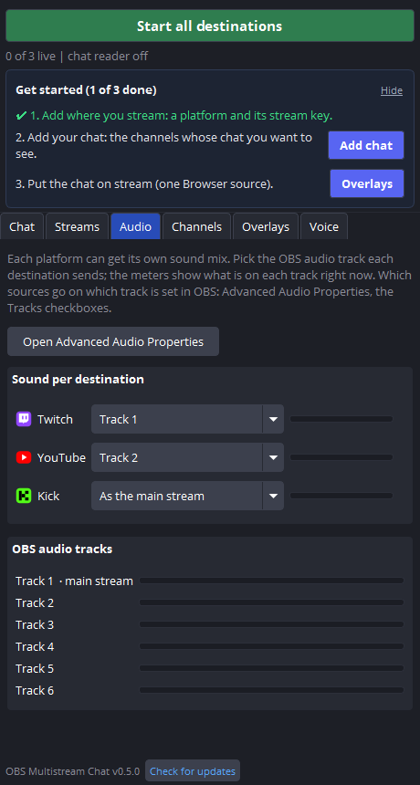 |

**4. Add your chat.** Press **Add chat** (or open the **Channels** tab). Pick the platform, type the channel
(or paste its link) and press **Add**; do the same for a collaborator's channel when you stream together.
**YouTube: type your channel as `@yourchannel`.** The reader finds the live stream on it by itself, every time
you go live (a video link or id still works too). **Add my channels from Streams** adds your own Twitch, Kick,
TikTok and YouTube channels from your destinations' handles; it only adds what is missing and never changes a
channel you added yourself. Under **Chat reader**, choose when it starts: only when you press Start, when OBS
starts, or when you go live. Read [Merged chat](#merged-chat) once before you use it.

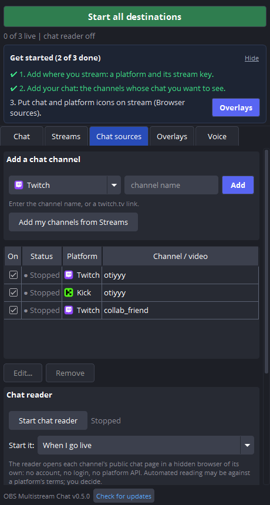

**5. Put the chat on stream.** Open the **Overlays** tab, press **Copy link** under *Chat on stream*, then in
OBS **Sources > + > Browser**, paste it into *URL*, width **800**, height **400**. Each line shows a small logo
of the platform next to the sender's name, nothing else. (*Platform icons*, a row of logos lit while each
destination is sending, is optional.)

| Overlays tab | What viewers see (on a dark scene) |
|---|---|
| 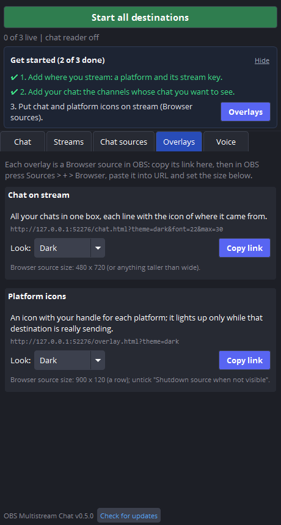 | 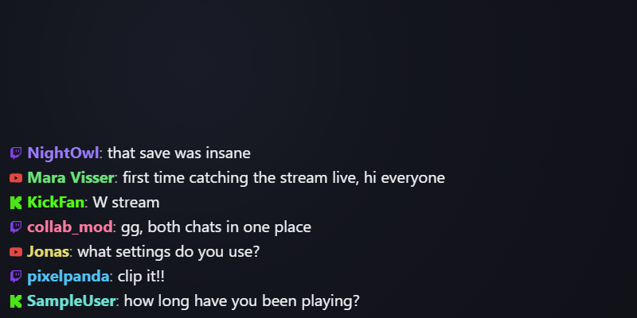 |

**6. Go live.** Start your normal OBS stream: destinations with *Start with the main stream* go live with it
(or press the big **Start all destinations**). The line under the button says how many are live, the total
bitrate and whether chat is being read. The **Chat** tab shows the merged chat for you; a number on the tab
counts lines you have not seen yet.

**7. Optional: read chat aloud.** The **Voice** tab reads chat with voices that run on this PC, with **its own
voice per platform** if you like (Twitch in one voice, YouTube in another; ▶ plays a sample). Your choices are
remembered. See [Chat voices](#chat-voices-voice-reader). (The picture comes from a test copy without voice
packs installed, hence "No voices installed".)

| Chat | Voice |
|---|---|
| 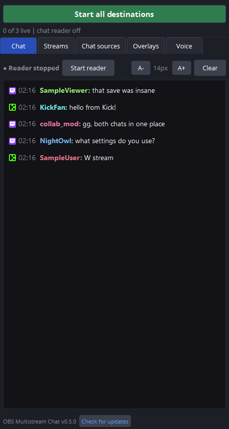 | 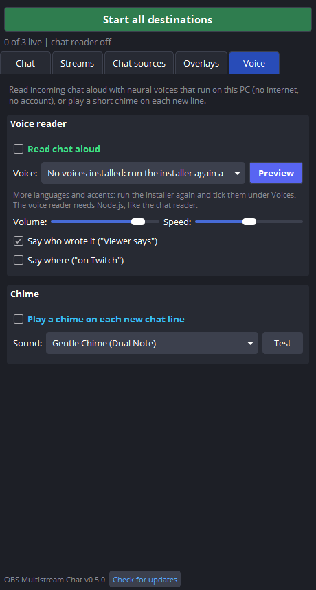 |

**Light hardware:** the hidden browser that reads chat runs in a low-memory mode: about 0.4 GB for five chats
instead of 1.2 GB, under 1 % CPU on the test PC. Numbers and method: [docs/benchmarks.md](docs/benchmarks.md).

## Finding the panel

- **Docks > OBS Multistream Chat** (OBS 30 and older: *View > Docks*): the dock, like every other.
- **Tools > OBS Multistream Chat**: opens (or raises) the same panel. If the dock was not registered it opens in
  its own floating window, which you can leave floating or drag into a dock area.
- The OBS log (Help > Log Files > View Current Log) says which happened: `dock registered`,
  `dock registration returned false`, or `frontend main window not ready`, plus `Tools > OBS Multistream Chat added`.
- Layout (since 0.5.1): the big **Start/Stop all destinations** button and a line such as
  `2 of 3 live | 11800 kbps | chat: 3 of 3 sources reading` stay at the top; under them one row of tabs:
  **Chat** (the merged chat for you), **Streams** (destinations: status dot, handle, audio track, and while
  anything is live bitrate, dropped %, uptime; Start/Stop per row), **Audio**, **Channels**, **Overlays**, **Voice**.
  The version and *Check for updates* are in the line at the bottom.

## Setup

1. **Streams > Add...** (or **Add destination** on the Get started card).
2. Pick the platform. The server URL is filled in (and hidden) where the platform has one fixed ingest;
   for Kick, TikTok, Trovo and custom servers the URL field shows: paste it from the platform's dashboard.
3. Paste the stream key (masked; **Reveal** shows it). Type the handle you want shown on stream.
4. Leave **Advanced options** closed unless you want another canvas, another resolution, another
   audio track, a delay or Aitum's settings for this destination (next section).
5. Start your normal OBS stream. Destinations with *Start with the main stream* go live with it.

### Canvas, encoder and audio track per destination (0.3.0)

- **Canvas.** *Main canvas* is what OBS streams. Any other canvas OBS has (Aitum Stream Suite makes them at
  startup) can be chosen from the list. A destination on another canvas always uses **its own video
  encoder**, because the resolution differs: pick the encoder (*x264* is the safe default; hardware encoders
  are listed with a note, each one uses one of your GPU's few encode sessions), bitrate, keyframe interval,
  preset, profile, rate control, an optional rescale and a frame-rate divisor. If the canvas is not there at
  start (Aitum creates its canvases a few seconds after OBS opens), the row says so and retries; nothing
  crashes.
- **Audio track.** *As the main stream* carries whatever the main stream carries. *Track 1 to 6* carries that
  OBS mixer track (the names come from Settings > Output > Advanced > Audio, if you named them; sources are
  routed to tracks in Advanced Audio Properties). With **shared** video you get the main stream's audio
  encoder if it already encodes that track; any other track gets its own AAC encoder (you pick the bitrate).
  With an **own** encoder the audio is always its own AAC encoder on the track you pick. If no source is
  routed to the track the OBS log says so (that track would be silent).
- **Stream delay** per destination (own and shared outputs alike); OBS's own stream delay still applies to
  the main stream only.
- **Limit of shared mode:** one bitrate, resolution, frame rate and keyframe interval for all shared
  destinations, and the audio is limited to the tracks the main stream encodes (anything else costs a small
  extra AAC encode). The dock explains this under the fields.
- **Aitum Stream Suite.** *Copy once* or *Follow* an Aitum output's settings; details, the file layout and
  what is and is not mapped are in [docs/aitum.md](docs/aitum.md).
- **More than two destinations at once** is a design goal and is covered by a test with eight mock outputs,
  including start/stop order and one output failing while the rest run. It has not run against eight real
  RTMP connections yet.

| Platform | Where to find the key | Default URL in the dialog |
|---|---|---|
| Twitch | Creator Dashboard > Settings > Stream > Primary Stream key | `rtmp://live.twitch.tv/app` (RTMPS also works) |
| YouTube | YouTube Studio > Create > Go live > Stream > Stream key | `rtmp://a.rtmp.youtube.com/live2` (or `rtmps://a.rtmps.youtube.com:443/live2`) |
| Facebook | Live Producer > Streaming software > Stream key (make it persistent) | `rtmps://live-api-s.facebook.com:443/rtmp/` |
| Kick | Creator Dashboard > Stream: copy the Stream URL **and** the key | none: account specific |
| TikTok | TikTok LIVE access / LIVE Studio: copy the Server URL **and** the key | none: account specific |
| Trovo / other | the provider's RTMP server and key | none |

These defaults come from the platforms' public help pages as remembered when this was written and could
not be re-checked offline: **confirm them on your dashboard.** Platforms change keys and ingests.

### Add the overlay to OBS

1. **Overlays > Platform icons > Copy link** (pick the look first: dark, transparent or light).
2. OBS: **Sources > + > Browser**, paste the URL, width 900 and height 120 (vertical: see below),
   untick "Shutdown source when not visible" and "Refresh browser when scene becomes active".
3. Tune it with query options appended to the URL:

| Option | Values | Default |
|---|---|---|
| `theme` | `dark`, `light`, `transparent` | `dark` |
| `layout` | `h` (row), `v` (column) | `h` |
| `size` | icon size in px, 16 to 256 | 48 |
| `accent` | `RRGGBB` accent for platforms without a brand colour | `7c5cff` |
| `names` | `1` show handles, `0` icons only | 1 |
| `hide_idle` | `1` hide anything not connected | 0 |

Example: `http://127.0.0.1:51734/overlay.html?theme=transparent&layout=v&size=64`. The port is chosen
once and remembered; if it is taken later a new one is used and the dock says so. If the plugin stops
answering, the overlay dims everything instead of showing a stale "live".

## Merged chat

One chat for all your platforms, in one OBS browser source, with an icon per line for the platform it
came from. Nothing is sent to any platform, you never log in, and no API, token or OAuth is involved.

**How it works.** The **Chat reader** (Channels tab) starts `node reader\index.js` as a hidden child process. That
program opens each chat page you added in a *headless Chrome of its own* (a throw-away profile that is
deleted when it exits, no extension, no cookies kept, no window), watches the page's chat list, and
posts the lines it sees to this plugin over `127.0.0.1`. The plugin cleans them (plain text only),
removes duplicates, puts them in order, applies your blocklist and serves them to the overlay.

**Need:** Node.js 22 or newer (`node` on PATH, or set `chat.node_path` in the plugin's `config.json`) and
Google Chrome or Chromium in its normal place (Microsoft Edge as a last resort; the environment variable
`OMSC_CHROME` can name any other). Nothing else is installed or downloaded.

**Read this first** (details in [docs/limits.md](docs/limits.md) and [docs/security.md](docs/security.md)):

- Reading a platform's pages automatically **may be against that platform's terms of service**. You
  decide; the plugin only reads the chat of channels you add, never sends, never logs in.
- Platforms can change their pages or block automated browsers at any time. A page that stops working
  shows up in the dock as **"Page layout changed or login needed"**, never as silence. A layout change
  is fixed by editing one small file in `reader\adapters\` (JSON selector packs), no rebuild.
- **TikTok and X are experimental.** TikTok may show a captcha or login; X broadcasts usually need a
  logged-in account to show chat. When that happens the dock says **"Needs login"** and nothing is read.
  The reader will not log in for you.
- A live check by the project coordinator found Twitch working (about 79 lines in 150 s, no duplicates); Kick found its chat list but
  no lines (see the Kick row below); YouTube did not load its chat in the EU (the consent page, now handled). **Nothing else has been
  tried against a real page by the author** (that was not allowed while building): use the checklist below.

### Set it up

1. **Channels > Add a chat channel**: pick the platform and enter the channel (Twitch, Kick), your channel as
   `@name` (YouTube: the reader looks up the live stream on `youtube.com/@name/live` by itself, and again every
   2 minutes while you are not live; a channel id `UC...`, a video link or an 11-character video id also work),
   the `@username` (TikTok) or the broadcast link `x.com/i/broadcasts/...` (X), then **Add**. Only the
   platform's own links are accepted; the same channel is never added twice. **Add my channels from Streams**
   adds one per Twitch, Kick, TikTok and YouTube destination with a handle, add-only.
2. **Chat reader > Start chat reader** (or **Start reader** on the Chat tab). Each source shows its status:
   *Starting*, *Reading*, *Quiet*, *Page layout changed or login needed*, *Needs login*, *Error*.
   **Start it:** *Only when I press Start*, *When OBS starts* or *When I go live*. Press the button again,
   or close OBS, to stop it; Chrome goes with it.
3. **Overlays > Chat on stream > Copy link**, then in OBS add a **Browser** source with that URL (for
   example 800 x 400). More options go in the URL: `?theme=dark|light|transparent&font=22&size=18&max=30&fade=0&colors=platform|hash|off&emotes=1&align=bottom&backlog=30`
   (`size` = the platform logo next to each name, in pixels, default 0.8 x the font; `fade` = seconds until a line disappears, 0 = stay).
4. Optional: **Filters** (Channels tab) hide commands (`!word`), well-known bots, blocked words and
   blocked users.

### Live checklist (to do once, by you)

Nothing here was run against a real platform. For each platform you use:

| Platform | What to add | What you should see | If not |
|---|---|---|---|
| Twitch | your channel name, e.g. `shroud` | status *Reading* within ~30 s; new chat lines in the overlay with the purple icon | *Page layout changed*: open `https://www.twitch.tv/popout/<channel>/chat` in Chrome, compare with `reader\adapters\twitch.json`, fix the selectors |
| YouTube | your channel as `@name` (or the id of a **live** stream) | *Reading* once you are live (verified on a real channel: 2.5 s), *Channel offline* before | same, `youtube.json`; a stream with chat off or members-only shows nothing |
| Kick | channel name | *Reading*, lines with the green icon | same, `kick.json` (Kick changes markup often) |
| TikTok (experimental) | `@username` of someone who is **live now** | *Reading* with lines, or *Needs login* | expected sometimes; nothing to fix on your side |
| X (experimental) | link of a running broadcast | *Needs login* is the likely answer | expected; there is no workaround here |

**New states in the dock** (so a silent source always says why): *Blocked by the platform's cookie-consent page*,
*Chat is disabled for this stream*, *Replay only: not a live stream*, *Channel offline (no messages)*, besides the older ones.
For YouTube in the EU the reader sets YouTube's consent *preference* cookie (`SOCS`, not a login, see docs/security.md) in
its own throw-away browser before loading the chat page; it never clicks anything.

**User agent:** by default the hidden Chrome presents itself as the installed Chrome (its own version, without the word `Headless`),
because YouTube serves an empty page to the headless agent. Set `"user_agent": "headless"` in the `chat` block of the plugin's
`config.json` to turn that off. Nothing else about the browser is disguised; see docs/limits.md. A page that loads empty shows as
*Empty page served*.

**Seeing what a page looks like, without sharing chat:** `node reader\index.js --diagnose --config <reader-config.json>`
loads each configured page once (about 25 s, `--wait <seconds>` to change) and prints JSON lines with **structure only**:
selector match counts, the tag/class path of the chat list, the tag/class shape of the first message row, data-attribute
*names*, iframe host names, and yes/no for each state word. No message text, author names, attribute values or tokens.
The reader config is `chat-reader.json` next to the plugin's `config.json` (written when you press Start once).

Also check once: the lines appear **once** (no doubles), the **order** is right when two platforms are
busy, and `chat-reader.log` (next to `config.json`) has no errors. It lists states and errors only,
never chat text. When something is wrong, `reader\adapters\<platform>.json` and the status text in the dock
are where to look; open an issue with the platform and the status text, not with a screenshot of chat.

## Chat voices (voice reader)

The **Voice** tab can read chat aloud with neural voices that run on your PC: no internet, no
account, nothing sent anywhere. They are [Kokoro](https://huggingface.co/hexgrad/Kokoro-82M) and
[Piper](https://github.com/OHF-Voice/piper1-gpl) voices run by [sherpa-onnx](https://github.com/k2-fsa/sherpa-onnx):
185 voices in 43 languages (`voice/catalogue.json`), including Scottish, Northern and Southern English,
Welsh, Flemish, Mexican and Argentinian Spanish, and European and Brazilian Portuguese.

- **Included in Setup:** Kokoro, 54 voices in American and British English, Spanish, French, Hindi, Italian,
  Japanese, Brazilian Portuguese and Mandarin. Other languages and accents are ticked in Setup and downloaded
  then; run Setup again to add more.
- **Needs Node.js 22+**, like the chat reader. The voices run in a helper of their own
  (`data\voice\index.js`), never inside OBS, so a voice problem cannot crash OBS. Its log is
  `voice-helper.log` next to the plugin's `config.json`.
- **A voice per platform:** under *Voice per platform* pick a voice for Twitch, YouTube, Kick, TikTok and X
  ("Same as the main voice" by default; the play button next to each plays a sample). A voice that is no longer
  installed falls back to the main one. Everything on the Voice tab is remembered (`ui-state.ini` next to
  `config.json`).
- Links are read as "a link"; emoji, spam runs ("noooooo") and very long messages are trimmed. When chat
  is faster than the voice, the oldest waiting lines are skipped. **Preview** cuts off whatever is
  playing.
- Every voice pack is checked before it ships: its archive must match a pinned SHA-256, and its own model
  card must name a licence that allows redistribution and commercial use (`scripts/fetch-voices.js`).
  Every catalogue voice ships by choice, but the licence check still labels each one: voices marked
  **[non-commercial]** come under a non-commercial licence (do not use them on a monetised stream), and
  **[licence unclear]** means the voice's terms could not be confirmed. See NOTICE and `docs\voice-licences.md`.

## Troubleshooting

- **Dock missing:** Docks > OBS Multistream Chat (older OBS: View > Docks), or Tools > OBS Multistream Chat. Check OBS's log (Help > Log Files) for lines starting
  `[obs-multistream-chat]`. Keys never appear there.
- **Start is greyed out:** a destination without a stream key cannot start. In *Shared* mode a destination can only start while the main stream is
  live. Start the main stream, or switch that destination to the x264 encoder.
- **Stays "Connecting" then "Reconnecting":** wrong URL, wrong key, blocked port (RTMP uses 1935,
  RTMPS 443), or the platform is not accepting the key yet. The tooltip on the status shows the reason.
  Retries back off from 1 s up to 60 s and stop after 8 failed tries ("Failed"); press Start to retry.
- **Amber "Degraded":** the output is connected but dropping at least 3 % of frames or sending under
  half the expected bitrate for 5 s. The banner says whether the network or the encoder/GPU is the cause.
- **Platform says offline though the icon is lit:** the icon means "OBS is connected and sending",
  nothing more. Platforms take a few seconds to show a stream and some need the stream key's
  "go live" step. No API means no confirmation from the platform (see docs/limits.md).
- **"Stream key cannot be decrypted":** keys are tied to your Windows user. Re-enter the key if the
  config was copied from another account or PC.
- **Keys with an older config:** a `config.json` from a newer version is opened read-only.
- **Broken config:** a damaged `config.json` is renamed `config.json.bad-<n>` and you start empty.

### Antivirus (Norton and others)

Freshly compiled, unsigned DLLs and test executables are commonly flagged by heuristic scanners
(Norton reports them as `IDP.Generic`) and may be removed mid-run. That is a false positive of the
"new unknown file" kind; nothing in this project is evading or hiding anything. ALL compiled output (CMake tree, test
executables, the plugin DLL, generated import libraries, the package zip) goes under one central folder,
`D:\builds\obs-multistream-chat\` by default (override with `-BuildRoot` or the environment variable
`OMSC_BUILD_ROOT`). Excluding that one folder is enough. This is your decision and your action:

- To restore a blocked file in Norton: open Norton, **Security > History**, show the protection or
  quarantine history, select the item, and choose **Restore & Exclude** (menu names vary by version).
- To exclude a folder without a detection: Norton **Settings > Antivirus > Scans and Risks > Items to
  Exclude from Scans** (and *Exclude from Auto-Protect*), then add `D:\builds\obs-multistream-chat` (just that folder; **not** `D:\builds` itself, which holds other
  projects).
- **Tradeoff:** anything placed in an excluded folder is no longer scanned. Only build code you have
  reviewed there, and never drop downloaded files into it. Sources, the SDK download cache
  (`build\downloads` inside the repo, archives only) and the `.obs-sdk` / `.qt-sdk` headers stay in the repo.
- The built binaries carry version information (company, product, description, version) to make them
  easier to recognise. A release zip is not code-signed.

## More

- [docs/security.md](docs/security.md): what is stored where, how keys are protected, the local server.
- [docs/limits.md](docs/limits.md): what this deliberately does not do.
- [docs/aitum.md](docs/aitum.md): using Aitum Stream Suite's output settings, where its file lives, double-streaming warning.
- [PROJECT.md](PROJECT.md): design, threading, config format, decisions, known problems.
- [NOTICE](NOTICE): third-party icons and trademarks.
